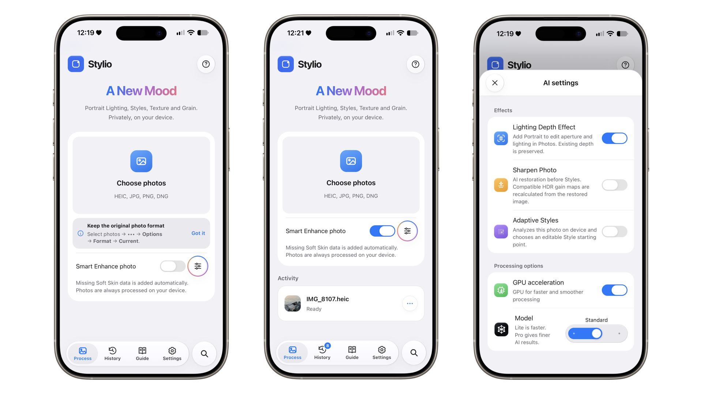
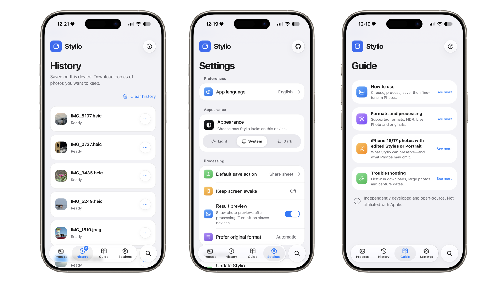
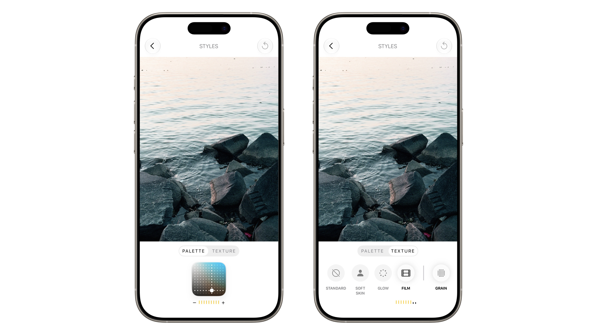

# Stylio

**English** · [Tiếng Việt](docs/readme/README.vi.md) · [简体中文](docs/readme/README.zh-CN.md)

**Stylio** - a name formed from Styles and Elio - is an open-source, on-device photo processing tool focused on interoperability with Apple Photos: Photographic Styles, iOS 27 Texture/Grain, AI-powered Portrait, and preserving as much original photo data as possible.

> [!NOTE]
> Current version: **v1.0.0**  
> Independent and open-source. Not affiliated with Apple.

## Try it

**Web app:** https://wanthinnn.github.io/stylio

Stylio runs locally in your browser. Your photos are not uploaded.

On iPhone, add Stylio to the Home Screen for the full-screen PWA experience.

## Preview

  
  
  

## Main features

- **Photographic Styles porting** for supported older-iPhone HEIC photos.
- **Texture & Grain** metadata support for the iOS 27 Photos editing controls.
- **AI Portrait / Depth Effect** with editable aperture and Portrait Lighting on supported outputs.
- **Smart Enhance** features including local detail restoration and Adaptive Styles analysis.
- **Original-data preservation** for existing HEIC/HDR/Portrait/Styles resources whenever the source provides them.
- **HEIC, JPEG, PNG and DNG** input support in the browser workflow.
- **Local-first processing** with optional WebGPU acceleration and CPU fallback.
- **PWA app shell**, persistent History, Light/Dark/System appearance, and English/Vietnamese/Chinese UI.

## Basic workflow

1. Open Stylio and choose a photo.
2. Optionally enable **Smart Enhance** or configure individual AI features.
3. Process the image.
4. Save the result as a file.
5. Open it in Apple Photos and continue editing there.

Keep your originals. Stylio rewrites photo files and remains experimental.

## Documentation

The detailed material that used to make this README very long now lives in `docs/`:

- [Browser setup, compatibility and architecture](docs/web/browser-guide.md)
- [Photo processing, Portrait, HDR and DNG notes](docs/web/processing-guide.md)
- [AI model assets](docs/models/ai-assets.md)
- [CLI, upstream Shalielie heritage and reverse-engineering notes](docs/project/upstream-cli-and-research.md)
- [Technical findings and device experiments](facts.md)

The Python CLI is still included for research, batch work and compatibility testing, but Stylio's primary user experience is the browser/PWA app.

## Project origin

Stylio builds on [Shalielie by nathanatgit](https://github.com/nathanatgit/Shalielie) with [HoLanLa by joy-0220-yoj](https://github.com/joy-0220-yoj/HoLanLa.git) and retains its MIT license and copyright notice.

The browser/PWA experience, AI-assisted workflows, multilingual UI and current Stylio feature set are maintained by **Elio (WanThinnn)**.

## License

[MIT](LICENSE). Third-party AI runtimes/models keep their own licenses and notices under `web/vendor/`.

Apple, iPhone, Apple Photos and Photographic Styles are trademarks of Apple Inc. They are referenced only to describe interoperability.
